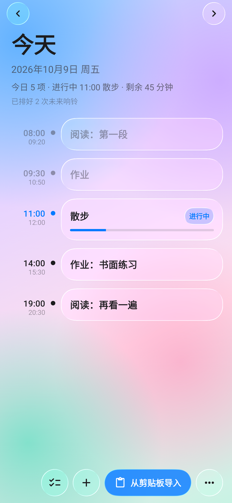
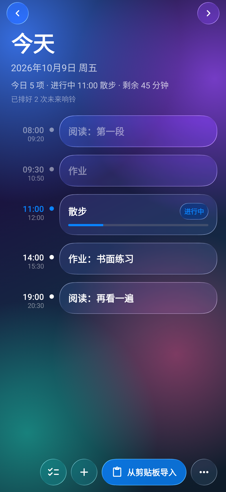
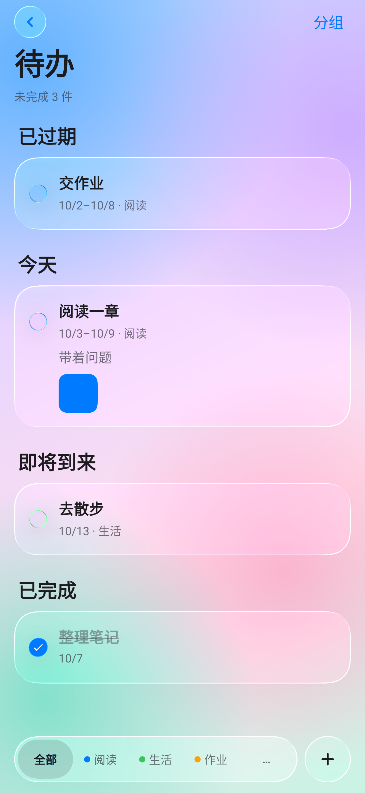
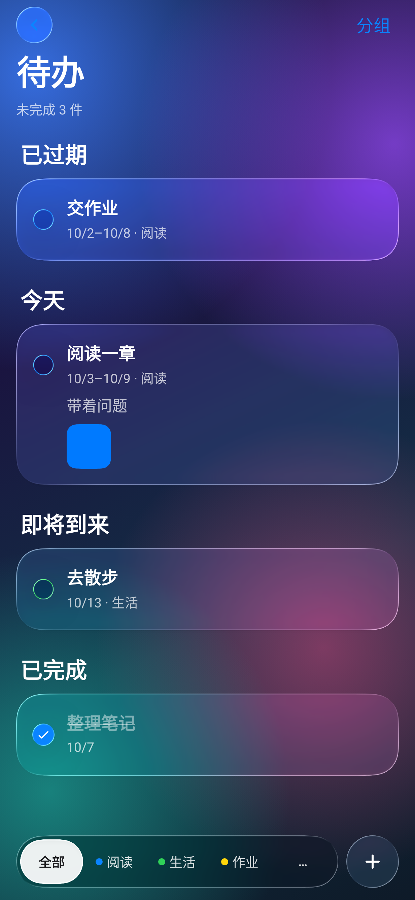

<div align="center">

# 学习提醒 · Study Reminder

**把一天的学习计划变成准点响铃的液态玻璃闹钟。**<br>
**A liquid‑glass study‑block alarm for Android — paste your day's plan, get an exact alarm at every block.**

[](../../releases/tag/v1.7.8)


[](LICENSE)

[中文](#中文) · [English](#english)

</div>

---

## 中文

一个给学生用的 Android 学习时段闹钟。把今天（或接下来几天）的计划贴进去，每个时间段开始时准点响铃、震动、弹出提醒；界面是 iOS 风格的液态玻璃，基于 [Kyant 的 AndroidLiquidGlass（Backdrop）](https://github.com/Kyant0/AndroidLiquidGlass)。

### ✨ 亮点

- **iOS 风格液态玻璃界面**：模糊、透镜折射、色散、镜面高光，按钮按下鼓起、随拖动方向拉伸，松手弹回；浅色 / 深色 / 跟随系统，可换自己的背景图。
- **计划 + 待办**：计划是一天里的时间段；待办像 iOS「提醒事项」，支持分组、颜色、截止日期、提醒时间、图片。
- **一段纯文本就能导入**：`#PLAN` 写计划、`#TODO` 写待办，从剪贴板、`.txt` / `.ics` 文件或你自己的网址同步，导入前有预览。
- **准点精确闹钟**：使用 Android 精确闹钟，锁屏、省电时也按分钟响；可选「全屏响铃」或「超级岛 + 悬浮通知」（小米澎湃 OS 焦点通知、Android 16+ 实时活动倒计时）；支持「5 分钟后再提醒」。
- **在 Android 17 上实测**（澎湃 OS 3）；最低 Android 13。
- **不收集任何数据**：没有账号、没有统计；网址同步默认关闭，不填就不联网，照片只存在手机本地。
- 内置主流国产 ROM（小米、华为、荣耀、OPPO、vivo、三星）的自启动 / 后台设置引导。

### 📸 截图

| 今日计划（浅色） | 今日计划（深色） | 待办（浅色） | 待办（深色） |
| :---: | :---: | :---: | :---: |
|  |  |  |  |

> 截图里的计划和待办都是虚构的示例数据。

### 📦 安装

1. 到 [Releases](../../releases/tag/v1.7.8) 下载 `study-reminder-v1.7.8.apk`（正式签名包）。
2. 在手机上打开 APK；如被拦截，允许「安装未知来源应用」。
3. 首次打开会进入「权限检查」，把通知、精确闹钟、全屏提醒、忽略电池优化、自启动逐项点到绿色。
4. 点右下角「…」→「5 秒后测试提醒」，确认锁屏时也能响。

更完整的使用说明（各品牌设置、导入规则、主界面操作）见 [docs/USAGE.zh-CN.md](docs/USAGE.zh-CN.md)。

### 📝 计划文件格式

```text
#PLAN 2026-09-27 周日安排
08:00-08:20 晨间阅读 | 读完一节就停
08:20-08:40 作业：书面练习 | 写完练习就停
14:00 散步
21:50-22:05 收尾

#TODO
read | 阅读一章 | 2026-10-01 | 2026-10-07 | 2026-10-03 09:00 | 带着问题 | 组:阅读
walk | 去散步 | 2026-10-08 | 组:生活
hand | 交作业 | 2026-10-09
```

- `#PLAN YYYY-MM-DD 标题` 设定后面几行的日期，可以写多段一次导入多天。
- 每行 `HH:MM-HH:MM 标题 | 备注`；结束时间、备注都可省略；结束早于开始按跨天处理。
- `#TODO` 每行：`编号 | 标题 | 开始日期 | [结束日期] | [提醒 YYYY-MM-DD HH:MM] | [备注] | [组:名字]`。
- 也支持 `.ics` 日历文件（读取 `DTSTART`/`DTEND`/`SUMMARY`/`DESCRIPTION`，`X-WR-CALNAME` 作为当天标题）。示例：[`samples/2026-09-27-reading.ics`](samples/2026-09-27-reading.ics)。
- 再次导入只替换那一天导入来的条目，手动添加的会保留。
- 计划时间按北京时间（UTC+8）计算。

### 🛠 本地编译

需要 JDK 17+ 和 Android SDK（compileSdk 37，targetSdk 36，minSdk 33）。

```bash
echo "sdk.dir=/path/to/Android/sdk" > local.properties
./gradlew test            # 单元测试（含 Robolectric 截图测试，输出在 app/build/shots）
./gradlew assembleDebug   # 调试包
```

正式包需要发布证书：复制 `keystore.properties.example` 为 `keystore.properties`，把 `.jks` 放进 `keystore/`（均已被 `.gitignore` 忽略）。没有证书时 `assembleRelease` 会拒绝打包。只有用同一张证书签名的包才能覆盖安装 Releases 里的正式版。

技术栈：Kotlin · Jetpack Compose · Material 3 · WorkManager · AlarmManager（精确闹钟） · [Backdrop](https://github.com/Kyant0/AndroidLiquidGlass) `io.github.kyant0:backdrop:2.0.1` · `io.github.kyant0:shapes`。

### ⚠️ 已知限制

- 界面目前只有中文。
- 自启动无法被系统检测，只能手动确认；部分 ROM 的设置入口会改名。
- 勿扰模式可能挡住声音；「强行停止」应用后闹钟会被系统清掉，需要再打开一次。
- 网址同步由系统调度，约 2 小时一次。

### 🙏 致谢

- [Kyant0/AndroidLiquidGlass](https://github.com/Kyant0/AndroidLiquidGlass)：液态玻璃效果来自 Backdrop 库；部分交互（按压高光、阻尼拖动、底部分段条）改编自其 catalog 示例，详见 [NOTICE](NOTICE)。

### 📄 许可

[Apache License 2.0](LICENSE)。

---

## English

An Android alarm app for study blocks. Paste today's (or the next few days') plan and it rings, vibrates and shows a heads‑up reminder exactly when each block starts. The UI is iOS‑style liquid glass, built on [Kyant's AndroidLiquidGlass (Backdrop)](https://github.com/Kyant0/AndroidLiquidGlass).

> **Note:** the app UI is currently **Chinese‑only**, and plan times are interpreted as China Standard Time (UTC+8).

### ✨ Highlights

- **iOS‑style liquid glass UI**: blur, lens refraction, chromatic dispersion and specular highlights; buttons swell on press, stretch along the drag and spring back. Light / dark / follow‑system, plus your own background photo.
- **Plans + todos**: plans are time blocks within a day; todos work like iOS Reminders, with groups, colours, due dates, reminder times and photos.
- **Import from plain text**: `#PLAN` for time blocks and `#TODO` for tasks, imported from the clipboard, a `.txt` / `.ics` file, or a URL you host yourself, with a preview before anything is saved.
- **Exact alarms**: uses Android exact alarms so blocks fire on the minute even when the phone is locked or saving battery. Choose full‑screen ringing or heads‑up + live countdown (HyperOS focus notification / “Super Island”, Android 16+ live updates), with snooze for 5 minutes.
- **Tested on Android 17** (HyperOS 3). Minimum Android 13.
- **No data collection**: no account and no analytics. URL sync is off by default, and photos stay on the device.
- Built‑in guides for autostart and background settings on Xiaomi, Huawei, Honor, OPPO, vivo and Samsung.

### 📸 Screenshots

See the table above. All plans and todos shown are fictional sample data.

### 📦 Install

1. Download `study-reminder-v1.7.8.apk` (release‑signed) from [Releases](../../releases/tag/v1.7.8).
2. Open it on your phone and allow “install unknown apps” if prompted.
3. On first launch, turn every item on the permission screen green: notifications, exact alarms, full‑screen intent, battery optimisation and autostart.
4. Tap “…” → “5秒后测试提醒” (test reminder in 5 s) to confirm it rings on the lock screen.

### 📝 Plan file format

```text
#PLAN 2026-09-27 Sunday
08:00-08:20 Morning reading | stop after one section
08:20-08:40 Homework: written exercises
14:00 Walk
21:50-22:05 Wrap up

#TODO
read | Read one chapter | 2026-10-01 | 2026-10-07 | 2026-10-03 09:00 | note | 组:Reading
walk | Go for a walk | 2026-10-08
```

- `#PLAN YYYY-MM-DD title` sets the date for the following lines; repeat it to import several days at once.
- Each line is `HH:MM-HH:MM title | note`. The end time and the note are optional, and an end time earlier than the start time rolls over to the next day.
- `#TODO` rows: `id | title | start date | [end date] | [reminder YYYY-MM-DD HH:MM] | [note] | [组:group]`.
- `.ics` calendar files work too (`DTSTART`/`DTEND`/`SUMMARY`/`DESCRIPTION`). Sample: [`samples/2026-09-27-reading.ics`](samples/2026-09-27-reading.ics).
- Re‑importing replaces only the imported items for that day. Items you added by hand are kept.

### 🛠 Build

You need JDK 17+ and the Android SDK (compileSdk 37, targetSdk 36, minSdk 33).

```bash
echo "sdk.dir=/path/to/Android/sdk" > local.properties
./gradlew test            # unit tests, incl. Robolectric screenshot test (app/build/shots)
./gradlew assembleDebug
```

Release builds need your own keystore: copy `keystore.properties.example` to `keystore.properties` and put the `.jks` file in `keystore/` (both are git‑ignored).

Stack: Kotlin · Jetpack Compose · Material 3 · WorkManager · AlarmManager · [Backdrop](https://github.com/Kyant0/AndroidLiquidGlass) 2.0.1.

### 🙏 Credits

Liquid glass rendering comes from Kyant's [AndroidLiquidGlass / Backdrop](https://github.com/Kyant0/AndroidLiquidGlass). Some interaction code (press highlight, damped drag, segmented tabs) is adapted from its catalog sample under Apache‑2.0. See [NOTICE](NOTICE).

### 📄 License

[Apache License 2.0](LICENSE).
